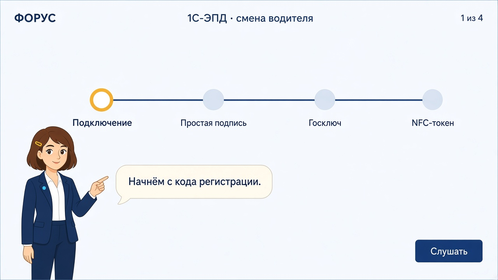
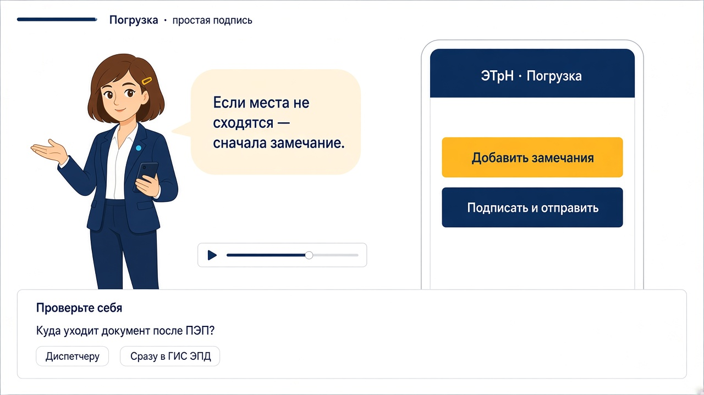
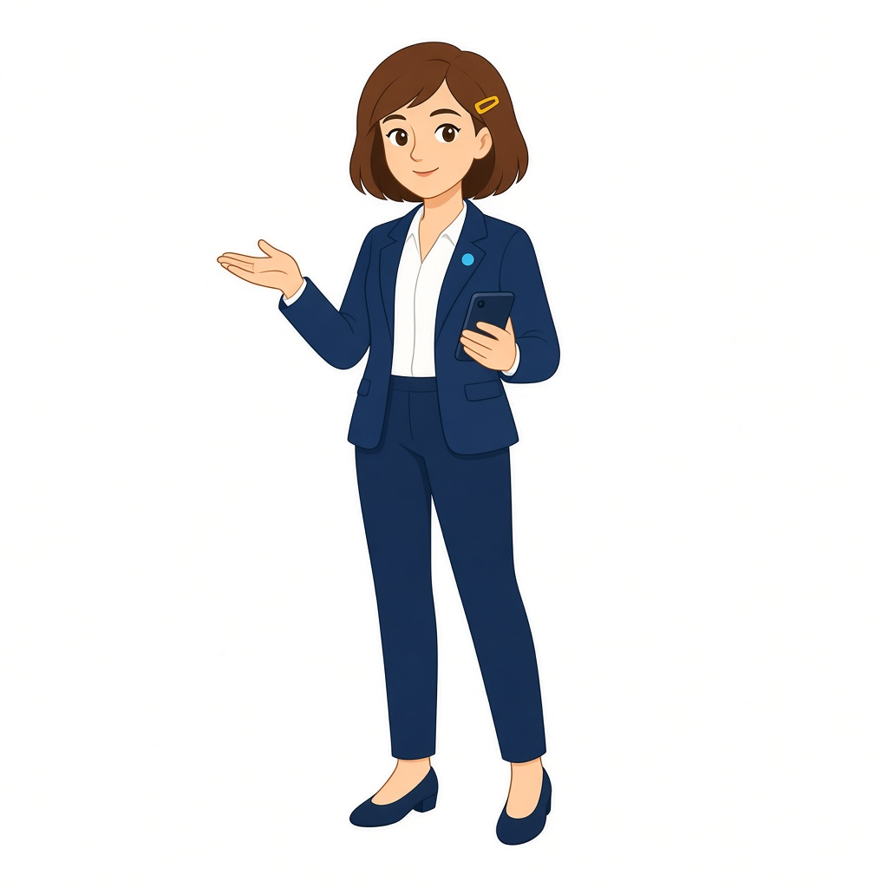
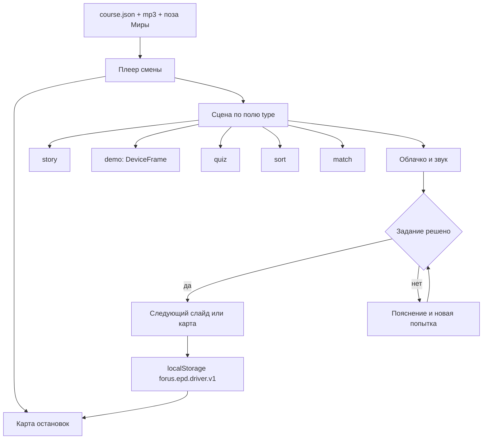
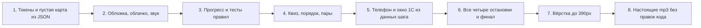

# ТЗ. Интерактивный веб-курс «Мобильное приложение 1С-ЭПД для водителя»

Документ для вайбкодинга. По нему собирается одна веб-страница-смена, без PowerPoint и без отдельного мобильного приложения.

Рядом лежит машинная копия сценария: [`course.json`](course.json). Реплики, вопросы, верные ответы и шаги макетов реализуют из него. Этот файл объясняет, почему сценарий устроен так, как выглядит интерфейс и в каком порядке собирать проект.

Промпт для агента-сборщика:

> Собери веб-курс по `tz/1c-epd-voditel/TZ.md` и `tz/1c-epd-voditel/course.json`. Приложение положи в новый каталог `epd-driver-course/`. Реплики, вопросы и подписи кнопок бери из JSON и не переписывай. Не добавляй слайды, баллы, таймер и новые типы заданий. Сначала каркас и плеер, затем типы сцен, затем подключение контента. Пока нет mp3, кнопка «Слушать» читает поле `narration` через Web Speech API, язык `ru-RU`.

## 1. Продукт

Одна смена на 12–18 минут. Зритель проходит четыре остановки. На каждой Мира, маскот курса, проговаривает короткий текст, тот же текст виден в облачке. Когда реплика дослушана или зритель сам нажал «К заданию», открывается одно действие для закрепления.

Курс учит водителя и того сотрудника, который водителя подключает. Тон спокойный, на «вы», без продавцового захода и без экзаменационного давления. Ошибаться можно. Верный ответ нужен, чтобы открыть следующий шаг. Оценка в конце считает только первые попытки и ни на что не влияет.

Тема этой смены, и только она:

1. Как подключить приложение.
2. Как подписать ЭТрН простой подписью.
3. Как подписать ЭТрН через Госключ и чем это отличается от УКЭП с телефона.
4. Что такое токен с NFC и как подключить его в 1С-ЭПД.

QR-код перевозки, путевой лист, медосмотр и роль механика в эту смену не входят. QR упоминается один раз, чтобы его не перепутали с кодом регистрации.

## 2. Формат

Веб-страница на React. Ощущение слайда 16:9 внутри браузера: на большом экране сцена лежит карточкой по центру, на телефоне складывается в колонку. Отдельной установки нет. Прогресс хранится в `localStorage`, ключ `forus.epd.driver.v1`. Сервера, логина и выгрузки в СДО нет.

Два слоя:

- **Карта смены.** Четыре остановки на одной линии. Пройденная остаётся доступной, следующая открывается после заданий предыдущей, остальные закрыты.
- **Сцена.** Линейные слайды внутри остановки. Назад по уже открытым слайдам можно. Вперёд через нерешённое задание нельзя.

Петля одной сцены:

1. Вход на слайд. Если жест пользователя уже был (кнопка «Начать смену» или «Слушать»), реплика играет сама.
2. Облачко показывает тот же текст, что и звук. Под ним полоса воспроизведения: пауза, ещё раз, «К заданию».
3. Пока реплика идёт, задание видно и не нажимается.
4. Конец звука или «К заданию» включает задание.
5. Верное действие открывает «Дальше». После последнего слайда остановки зритель возвращается на карту.

На обложке и на финале задания нет.

## 3. Визуальный стиль Форус

Опора — шаблоны ГК «Форус» из этого репозитория: синий шаблон (`#395F75`, шафран `#FECF68`) и тёмный шаблон (акцент `#26A6E0`). В бренд-описании компании стиль сведён к лаконичности, воздуху, тонким линиям и крупным акцентным объектам. В вёрстке это значит: много пустого поля, одна крупная фигура на слайд, линия маршрута толщиной 2 пикселя, без теней, без градиентов, без иконок-эмодзи.

Страница вокруг слайда: `#E8EEF1`. Поле слайда: `#F7F9FA`. Слайд ограничен рамкой `1px solid #D5DEE3`, радиус 20px, максимальная ширина 1180px, минимальная высота на десктопе 640px. Тень не используется.

| Токен | Цвет | Куда |
| --- | --- | --- |
| `--navy` | `#395F75` | заголовки, основной текст облачка, главные кнопки, костюм Миры |
| `--ink` | `#1C2B33` | основной текст |
| `--slate` | `#767677` | вторичные подписи |
| `--saffron` | `#FECF68` | фон облачка, кольцо текущей остановки, вторая кнопка на макете телефона |
| `--saffron-soft` | `#FFF6DE` | фон облачка, если чистый шафран слишком яркий для абзаца |
| `--cyan` | `#26A6E0` | полоса звука, значок на лацкане, ссылка «К заданию» |
| `--line` | `#D5DEE3` | рамки и линия маршрута |
| `--locked` | `#E7E6E6` | закрытые остановки |
| `--ok` | `#00715D` | верный ответ |
| `--bad` | `#D74949` | неверный ответ, один раз на попытку |
| `--white` | `#FFFFFF` | карточки заданий и экран телефона |

Текст на шафране только цвета `--navy`. Шафран не используют как цвет мелкого текста на белом. Главная кнопка: фон `--navy`, текст белый, радиус 12px, высота 44px. Вторая кнопка на учебном телефоне может быть шафранной с текстом `--navy`, как «Добавить замечания» на макете.

Шрифт интерфейса — Manrope, запасной Arial. В презентациях Форус сейчас стоят Arial и Verdana; для веба берём один гротеск с кириллицей. Если у бренда появится свой веб-шрифт, меняется одна строка в `tokens.css`. Заголовки 28px, реплика 18px / 1.45, подписи 14px. Начертание заголовков 650, не чёрное.

Верхняя полоса слайда: слева слово «ФОРУС» капителью, по центру «1С-ЭПД · смена водителя», справа номер остановки «1 из 4». Логотип не перерисовывать. Пока нет официального SVG, остаётся текстовый знак.

Десктоп от 1024px повторяет макеты. Ниже 720px карта становится вертикальным списком остановок, Мира уменьшается до 180px по высоте, телефон и задание встают под облачком. Фокус клавиатуры видимый: обводка `--cyan` 2px.

## 4. Маскот

Рабочее имя — **Мира**, от формулы бренда «Мир IT в твоих руках». Имя живёт в одном поле `mascot.name`.

Утверждённый вид — [`assets/mira-reference.jpg`](assets/mira-reference.jpg):

- плоская векторная девушка, спокойная улыбка, каштановое каре;
- шафрановая заколка на левой стороне её головы, зритель видит её справа;
- тёмно-синий костюм с брюками и туфлями на низком каблуке, белая блузка;
- круглый голубой значок на левом лацкане;
- в опорной позе телефон в левой руке, правая рука открыта.

На слайде она стоит внизу левой колонки. Облачко выходит от неё, фон `#FFF6DE`, текст `--navy`, радиус 18px, максимальная ширина 420px.

Для первой версии хватает одной позы с референса. Новые ракурсы допустимы только как отдельные файлы того же персонажа. Генерировать новое лицо на каждый слайд нельзя. Синхронизация губ, моргание и видео персонажа не входят в первую версию: говорит звук и облачко.

## 5. Пять форматов слайдов

Больше форматов в этой смене нет.

| Тип в JSON | Что видит человек | Когда слайд закончен |
| --- | --- | --- |
| `cover`, `final` | Мира, реплика, одна кнопка | Нажатие кнопки |
| `story` | Мира, реплика, одна схема из карточек | Конец реплики, затем «Дальше» |
| `demo` | Учебный телефон или окно 1С, шаги по одному | Нажаты все подсвеченные кнопки шагов |
| `quiz` | Вопрос и варианты, один верный | Выбран верный вариант |
| `sort` | Четыре шага и кнопки «выше / ниже» | Порядок совпал |
| `match` | Три ситуации и три способа | Все пары верные |

`demo` — это и есть «нарисованный сервис». Один компонент `DeviceFrame` рисует и телефон, и окно 1С. Различаются данные шага: заголовок, строки, кнопки, какая кнопка подсвечена. Отдельный макет на каждый шаг не делать. На каждом таком слайде под рамкой виден общий дисклеймер из поля `disclaimer`.

Единственный жест сверх клика по кнопке — шаг `tap-token` на остановке NFC: токен на иллюстрации подносят к задней панели телефона, затем нажимают «Получить сертификаты». Это не отдельная игра.

Перетаскивание в сортировке можно добавить мышью, но кнопки «выше» и «ниже» обязательны: с клавиатуры и на телефоне задание решается ими.

После неверного ответа показывается пояснение из `feedback` или `retry`, выбор сбрасывается, можно ответить снова. Верный вариант подсветкой не выдаётся. В зачёт финала попадает факт первой попытки.

Явно не делаем в этой смене: пазл из кусков интерфейса, таймер, жизни, рейтинг, конфетти, встроенное видео реальной 1С, свободную песочницу сервиса.

## 6. Как устроены остановки

Полные тексты — в `course.json`. Здесь логика, чтобы при сборке не «улучшить» смысл.

### Обложка

Мира представляется и обещает четыре остановки. Кнопка «Начать смену» открывает карту и заодно разрешает дальнейшее автовоспроизведение.

### Остановка 1. Подключение

Сотрудник в журнале «Электронные перевозочные документы» открывает «Ещё → Взаимодействие с мобильным приложением», в справочнике «Мобильные устройства 1С-ЭПД» нажимает «Подключить», заполняет ИНН, СНИЛС, телефон, водительское удостоверение, роль, схему обмена, вид подписи и состав документов. Код регистрации водитель вводит в уже установленном приложении. После кода в телефоне видна организация.

Задания: один верный ответ про код регистрации и сборка четырёх шагов в верном порядке. Код регистрации и QR-код перевозки в ответах стоят рядом специально.

### Остановка 2. Простая подпись

Простая подпись фиксирует приёмку или сдачу груза внутри компании, с замечанием или без. Дальше титул подписывает уполномоченный сотрудник перевозчика. В курсе показываем рабочий путь 1С: его усиленная квалифицированная подпись. Имя схемы на слайде: «Обмен проектами титулов внутри организации».

Макет ведёт через раздел «Погрузка»: открыть накладную, «Погрузка», «Добавить замечания», текст расхождения, «Подписать и отправить». ПИН на этом пути не появляется. Итог на экране: отметка у сотрудника перевозчика.

Задание: при расхождении мест верный путь — замечание, затем подпись.

### Остановка 3. Госключ и УКЭП с телефона

Две колонки, без третьей про простую подпись: она уже пройдена.

- Госключ — усиленная неквалифицированная подпись, государственное приложение, сертификация ФСБ, вход через Госуслуги, токен не нужен, подписывается проект титула.
- УКЭП с телефона — квалифицированная подпись на Рутокен ЭЦП 3.0. Ей водитель отправляет титул погрузки (титул 2) и титул выгрузки (титул 4) другим участникам и в ГИС ЭПД.

Макет показывает только настройку Госключа: вид подписи «НЭП (Госключ)», предложение настроить обмен, вход на Госуслуги, «Уже установлено», флажок «Я установил приложение», подпись заявления-согласия. Экран самого подписания накладной в Госключе не выдумывать: в инструкции ИТС этого пошагового ряда нет.

Задание-развилка: прямая отправка титула погрузки — это УКЭП на Рутокене.

### Остановка 4. Токен с NFC

Токен хранит ключ. NFC-модель подносят к телефону с включённым NFC. USB Type-C вставляют в разъём. В обоих случаях дальше одно и то же: «Настройки → Рутокен → Получить сертификаты», выбор сертификата, ПИН в момент подписи. Сертификат тарифа «1С:Подпись.ЭПД.Мобильный». Подпись от лица перевозчика сопровождается машиночитаемой доверенностью. Закрытый ключ с носителя не копируется.

Задание: где остаётся ключ. Затем финальное сопоставление трёх ситуаций трём инструментам. Оно закрывает остановку и всю смену.

### Финал

Четыре фразы, по одной на остановку, и строка «С первого раза: N из 6». Шесть заданий — это два на первой остановке и по одному на второй, третьей, четвёртой, плюс сопоставление. Кнопка «На карту». Отдельного «удостоверения» и печати, похожей на документ, нет.

## 7. Озвучка

Поле `narration` — и текст облачка, и текст диктора, знак в знак. Реплика короче 400 знаков. Если мысль не помещается, она уже разрезана на следующий слайд, заново склеивать нельзя.

Файлы: `public/audio/<id слайда>.mp3`, моно, 64–96 кбит/с, без музыки. Голос один на всю смену: женский, взрослый, спокойный. Образцы снимают в SaluteSpeech или SpeechKit и выбирают один. Громкость выравнивают между файлами.

Пока файла нет, плеер читает `narration` синтезом браузера и не показывает зрителю техническую ошибку. Кнопка на макете подписана «Слушать». На обложке звук сам не стартует: первый звук разрешает «Начать смену».

«К заданию» доступна всегда. Кто читает быстрее диктора, не ждёт конца дорожки. Для кого звук недоступен, облачко и есть полный текст.

## 8. Макеты

Картинки задают композицию, цвет и характер Миры. Тексты заданий на картинках короче сценария. В код попадают строки из JSON.

Карта смены. Текущая остановка отмечена шафрановым кольцом, остальные спокойные. Мира указывает на первую.



Сцена объяснения. Слева Мира и облачко, под ними звук. Справа учебный телефон с реальными подписями кнопок. Снизу задание уже видно и до конца реплики не активно.



Опорный портрет для всех следующих поз:



## 9. Схема разработки

Сначала правила прохождения, потом картинка. Контент не зашит в компоненты: плеер читает JSON и выбирает сцену по полю `type`.



Порядок сборки. Каждый шаг заканчивается страницей, которую уже можно открыть в браузере.



Стек, который не обсуждается в процессе сборки:

- Vite, React, TypeScript;
- стили на CSS-переменных из раздела 3, без UI-кита;
- маршрутизатор не подключать: идентификатор слайда лежит в состоянии плеера;
- Vitest на чистые функции прогресса и проверки ответов;
- бэкенд, аналитика и авторизация не подключаются.

Каталог `epd-driver-course/`:

```text
src/main.tsx
src/App.tsx
src/tokens.css
src/content/course.json
src/player/Player.tsx
src/player/progress.ts
src/player/progress.test.ts
src/components/RouteMap.tsx
src/components/Mascot.tsx
src/components/SpeechBubble.tsx
src/components/AudioBar.tsx
src/components/DeviceFrame.tsx
src/components/Quiz.tsx
src/components/SortList.tsx
src/components/MatchBoard.tsx
public/audio/
public/mascot/mira-explain.jpg
```

`progress.ts` отдаёт наружу четыре вещи: открыта ли остановка, можно ли уйти со слайда, верна ли попытка, сколько первых попыток было успешными. Компоненты эти решения не дублируют.

Остановка считается пройденной, когда пройден каждый слайд из её `slideIds`. В зачёт «С первого раза: N из 6» попадают только слайды с `"gatesStation": true`. Если поля нет, задание в зачёт не идёт: рассказ и макет сервиса обязательны для движения вперёд и на оценку не влияют. Первая попытка фиксируется в момент первой проверки, повтор после пояснения зачёт не меняет.

`DeviceFrame` принимает `frame: "phone" | "desktop"` и объект `screen`. Подсвеченная кнопка — единственная активная на шаге. Остальные кнопки видны и не нажимаются, чтобы зритель видел соседние действия и не уходил в сторону. На шаге `tap-token` кроме кнопки активна иллюстрация токена.

Клавиатурный фокус после конца реплики встаёт на первый вариант ответа или на подсвеченную кнопку макета.

## 10. Приёмка

Смена считается собранной, когда выполняется всё из списка.

- В `slides` шестнадцать записей: обложка, четырнадцать слайдов остановок и финал. Карта собирается из `stations`, отдельным слайдом не считается. Все они открываются по порядку из JSON.
- Закрытую остановку нельзя открыть кликом.
- Облачко совпадает со звуком или с синтезом браузера.
- «К заданию» открывает ответ до конца дорожки.
- Неверный ответ показывает своё пояснение и оставляет новую попытку.
- Вперёд пускает только верное действие.
- На простой подписи нет поля ПИН. На NFC ПИН есть в последнем шаге.
- На Госключе нет выдуманного экрана подписания накладной.
- Дисклеймер учебного макета виден на всех `demo`.
- Обновление страницы возвращает на последнюю открытую остановку.
- Финал показывает «С первого раза: N из 6».
- На ширине 1440 и 390 нет горизонтального скролла сцены.
- `npm test` проверяет порядок сортировки, пары, верный вариант и правило открывания остановки.

Перед записью голоса методист сверяет три подписи со статусом `action-confirmed-label-check` в JSON: «Сгенерировать код регистрации», пункт списка для простой подписи, формулировку перехода в Госключ. Смысл шагов при этом уже зафиксирован инструкциями, менять его по вкусу нельзя.

## 11. Откуда взяты факты

Тексты для зрителя опираются на открытые инструкции, а не на память о продукте. Перед внешней публикацией методист ещё раз смотрит актуальную версию приложения: подписи кнопок в мобильном релизе меняются чаще, чем схема обмена.

- ИТС, «Подключение к мобильному приложению 1С-ЭПД»: журнал «Электронные перевозочные документы» → «Ещё» → «Взаимодействие с мобильным приложением» → справочник «Мобильные устройства 1С-ЭПД» → «Подключить».
- ИТС, «Подключение сотрудника с ролью Водитель», публикация 23.07.2026: ИНН, СНИЛС, телефон, водительское удостоверение, схема обмена, вид подписи, ЭТрН и/или ЭПЛ, код регистрации, ввод кода в приложении.
- ИТС, «Переподключение водителя к МП 1С-ЭПД», 22.09.2026: схема «Обмен проектами титулов внутри организации» для простой подписи и УНЭП Госключ; для прямой подписи водителем меняют схему, ставят «УКЭП Рутокен» и указывают доверенность.
- ИТС, «Подписание ЭПД УНЭП через приложение Госключ», 23.07.2026: вид подписи «НЭП (Госключ)», Госуслуги, установка, «Уже установлено», «Я установил приложение», заявление-согласие, далее проекты титулов. Там же: Госключ — государственный проект с сертификацией ФСБ.
- ИТС, «Подписание ЭПД УКЭП Рутокен ЭЦП», 22.09.2026: «Настройки — Рутокен — Получить сертификаты», NFC или USB, выбор сертификата.
- ИТС, статья обмена ЭТрН, и ответ Минтранса «Может ли водитель подписывать ЭТрН простой электронной подписью»: ПЭП или УНЭП водителя возможны при последующей подписи перевозчика. Минтранс указывает УКЭП или УНЭП перевозчика. Курс показывает частый путь в 1С, где сотрудник перевозчика ставит УКЭП, и не утверждает, что УНЭП перевозчика запрещена.
- ИТС, статья про отсутствие QR-кода: раздел «Погрузка», действия «Погрузка», «Подписать и отправить», «Добавить замечания». ПИН в той статье относится к пути, где титул 2 уходит в ГИС ЭПД, поэтому на макете простой подписи его нет, а на макете УКЭП есть.
- УЦ «НПЦ „1С“», страница об электронной подписи для ЭПД: тариф «1С:Подпись.ЭПД.Мобильный», носитель Рутокен ЭЦП 3.0, USB Type-C или NFC, ключ не покидает носитель, полномочия водителя подтверждает МЧД перевозчика.

Юридические номера постановлений в реплики Миры не класть. Они остаются в этом разделе для методиста.
